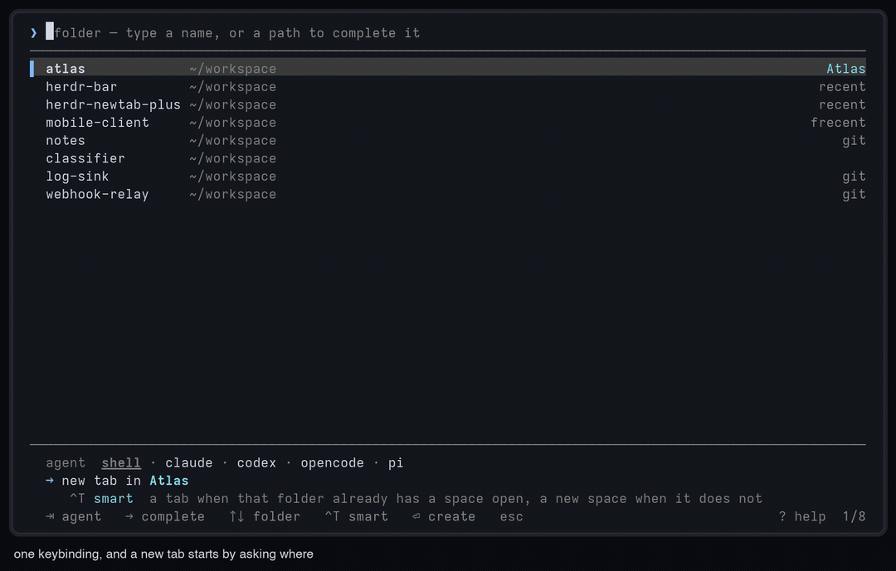

# herdr-newtab-plus — pick a folder, pick an agent, press Enter

[](https://github.com/jeffarese/herdr-newtab-plus/actions/workflows/ci.yml)
[](https://github.com/jeffarese/herdr-newtab-plus/releases/latest)

**A [Herdr](https://herdr.dev) plugin that replaces the new tab with a folder
picker.** Press your new-tab key, type a few letters of a project (or a path,
completed against the real filesystem), pick an agent, and Enter opens the tab
there with the agent already starting. A folder that already has a space gets
a tab in it; any other folder gets a space of its own.



- **the folders you use, before you type** — recent picks first, then folders
  that already have a space open (badged with its name and the status of any
  agent working there), then zoxide's frecency list, then your project roots.
- **real path completion** — type `/`, `~` or `.` and the list becomes the real
  subdirectories of what you named, prefix matches first, with a dimmed
  completion after the cursor that `⇥` accepts.
- **tab or space, decided for you** — a folder has a space when a pane in that
  space is standing in it, symlinks followed. `^T` switches between *smart*,
  *always a tab* and *always a space*, and stays where you leave it.
- **starts the agent** — a plain shell, or claude, codex, opencode, pi or any
  other agent Herdr can start that is installed. Each folder remembers the one
  you last opened it with. `^Y` starts it with its permission prompts off, for
  this tab only.
- **logos and live status** — every agent in its vendor's colour, with its
  logo when the Herdr Agent Icons Max font is installed, and Herdr's own status
  glyphs: `◉` needs you, `◐` working, `●` done, `✓` idle.
- **a preview of the folder** — its branch, the space it already has, the
  agents in it and what each is doing, and what is inside it.
- **one small native binary** — written in Rust, with no runtime to install.
  Herdr downloads the prebuilt binary for your platform when it installs the
  plugin. With 4,000 folders to offer, the first frame is on screen in about
  14 ms and a keystroke takes under a millisecond:
  [6× and 40× faster](#performance) than the Python release it replaces.

Before you type anything, the list is the folders you use, with what Enter will
do spelled out above the hints:

```
 ❯  folder — type a name, or a path to complete it
 ─────────────────────────────────────────────────────────────────────────────────────────────────────────
 ▌ atlas             ~/workspace                                                          claude · ◐ Atlas
   herdr-bar         ~/workspace                                                           codex · ◉ Herdr
   herdr-newtab-plus ~/workspace                                                           claude · recent
   mobile-client     ~/workspace                                                                   frecent
   classifier        ~/workspace
   log-sink          ~/workspace                                                                       git
   notes             ~/workspace                                                                       git
   webhook-relay     ~/workspace                                                                       git
 ─────────────────────────────────────────────────────────────────────────────────────────────────────────
   agent  shell   claude   codex   opencode   pi
   → new tab in Atlas  ·  claude                                                      smart   tab   space
     smart — a tab when that folder already has a space open, a new space when it does not
   ⇥ agent   → complete   ↑↓ folder   ^T smart   ^Y skip perms   ⏎ create   esc close          ? help  1/8
```

That is the plain-text view, with the folder preview hidden. In a terminal the
selected agent and create mode are drawn as pills, every agent is in its
vendor's colour, and with the [icon font](#agent-logos) each folder leads with
the logo of the agent it was last opened with, as in the GIF.

## Install

```bash
herdr plugin install jeffarese/herdr-newtab-plus
```

Requires Herdr 0.7.4+ (session-modal popup panes) on macOS or Linux, x86_64 or
ARM. Installing runs the plugin's build step, which downloads the release
binary for your platform and checks it against the release's `SHA256SUMS` and
the version it reports. If that fails, it builds from source with `cargo`
instead (Rust 1.88+). Set `HERDR_NEWTAB_PLUS_BUILD=source` to always build
from source.

Then open it with `herdr plugin action invoke herdr-newtab-plus.open`, or bind
it to a key (below). If something looks wrong, the binary diagnoses its own
environment: run `bin/herdr-newtab-plus --doctor` from the plugin's folder.

**Upgrading from 0.1.** 0.1 was a Python script; 0.2 is the same picker as a
native binary, with the same config, state and keys. `herdr plugin update
herdr-newtab-plus` reinstalls it, which runs the build step. Python is no
longer needed.

## Replacing the built-in new tab

Herdr's own new tab is a normal binding, so freeing its key hands it over.
Setting a built-in binding to `""` disables it. In `~/.config/herdr/config.toml`:

```toml
[keys]
# was: new_tab = "cmd+t"
new_tab = ""

[[keys.command]]
key = ["cmd+t", "prefix+t"]
type = "plugin_action"
command = "herdr-newtab-plus.open"
description = "new tab"
```

Then `herdr server reload-config`. To keep both, leave `new_tab` alone and bind
the plugin to a different key; nothing here depends on owning the original one.

## Using it

| key | what it does |
| --- | --- |
| type | filters folders; a `/`, `~` or `.` switches to completing real paths |
| `⇥` | accepts the completion while one is showing, otherwise moves the agent |
| `⇧⇥` | always moves the agent |
| `→` | fills the input with the highlighted folder, ready to go a level deeper |
| `↑` `↓` | move through the folders |
| `⏎` | create |
| `esc` | close |
| `ctrl+w` | delete back one path segment |
| `ctrl+u` | clear |
| `ctrl+r` | rescan the filesystem |
| `ctrl+t` | where Enter lands: decide for me, always a tab, always a new space |
| `ctrl+o` | show or hide the folder preview |
| `ctrl+y` | start the agent with its permission prompts off |
| `?` `F1` | the help panel: `?` while the input is empty, `F1` always |
| click | first click selects, second creates; click an agent to pick it |

The line above the hints always says what Enter is about to do. `?` gives the
whole popup over to what everything on screen does, and marks the create mode
you are on:

```
  what this popup does                                                                    ? or esc  close
 ─────────────────────────────────────────────────────────────────────────────────────────────────────────
   Type a folder, pick an agent, press ⏎. The line above the hints says what ⏎ is about to do.

   ^T         where ⏎ lands. Three positions, and it stays on the one you leave it on — popup to popup,
              and across restarts. You are on the marked one.
              ▌ smart  a tab in the space that folder already has, a new space when it has none — and it
                       "has a space" when some pane in one is standing in it, symlinks followed.
                tab    always a tab: in that folder's own space when it has one, otherwise in the space
                       you are looking at now.
                space  always a new space, even when the folder already has one.

   ^Y         starts that agent with its permission prompts off, for this tab only — never remembered,
              unlike the agent. claude and codex have checked flags; anything else refuses rather than
              guess until skip_permission_flags in config.json teaches it one.

   the list   before you type: folders picked recently, then ones that already have a space — badged with
              its name, and ◉ ◐ ● ✓ when an agent is in it — then zoxide's list, then the children of
              your roots. Type a / ~ or . and it completes real directories instead.

   the agent  a shell, or any agent Herdr can start that is installed here. Each folder remembers the one
              you last opened it with and shows it on its row; the new one is named after the folder.
 ─────────────────────────────────────────────────────────────────────────────────────────────────────────
   ⇥     complete, or move the agent             ^W    back one path segment
   →     fill in the highlighted folder          ^U    clear the input
   ↑↓    move the folders                        ^R    rescan the filesystem
   ⇧⇥    move the agents                         click select, click again to create
   ⏎     create it                               esc   give up and close the popup
```

A folder can have a `?` in its name, so `?` only opens the panel while the
input is empty. `F1` works whatever is typed, and the corner of the footer says
which of the two is live.

### Where the folders come from

Before you type anything, the list is, in order:

1. folders you picked recently
2. folders that already have a space open, badged with the space's name
3. zoxide's frecency list, if you have zoxide
4. every immediate child of your configured roots, badged `git` where it applies

A folder an agent is standing in shows that agent's status before its badge,
in the glyphs and colours of Herdr's sidebar (and herdr-bar's). With several
agents in one folder, the one that wants you first wins. A folder you have
opened with an agent before names that agent too, in its vendor's colour, or
leads its row with the agent's logo when the icon font is installed.

The list is capped at ten folders: the one you want is one you recognise in the
first few, and the counter in the corner says how many more there are.

Type a path (anything with a `/`, or starting with `~` or `.`) and the list
switches to the real subdirectories of what you named, prefix matches first. A
trailing `/` offers the folder itself as the top row and its children below, so
you can drill in and still pick the parent.

### Tab, or a space of its own

Herdr does not record a folder on a space; only panes carry a working
directory. So the rule is exact rather than a guess: a folder has a space when
some pane in that space is standing in it.

| `^T` position | line above the hints | what Enter does |
| --- | --- | --- |
| `smart` | `→ new tab in Atlas` | a tab in the space that folder already has, otherwise a new space |
| `tab` | `→ new tab in Atlas` | always a tab: in the folder's own space when it has one, in the focused space otherwise |
| `space` | `→ new space atlas` | always a new space, duplicate or not |

One key covers both, and the sidebar keeps one space per project instead of
collecting duplicates. The position you leave `^T` on is saved next to your
recent folders, so it survives the popup closing and Herdr restarting. `esc`
abandons the pick but keeps the setting. `create` in the config is where a
machine that has never pressed `^T` starts.

### Agents

The agent row offers a plain shell plus every agent Herdr can start that is
installed on this machine. The tab is created while you are still looking at
the last frame; the agent starts in the background, so the popup closes the
moment the tab exists rather than waiting for the agent to boot. It is named
after the folder, so `herdr agent focus my-project` works afterwards.

### Starting without permission prompts

`ctrl+y` arms the selected agent to start with its approval prompts off: what
you want for a tab you intend to walk away from. Armed, the chip gains a `!`,
the line above the hints reads `codex (skip permissions)`, and both turn
yellow:

```
   agent  shell   claude   codex!   opencode   pi
   → new tab in Atlas  ·  codex (skip permissions)                                    smart   tab   space
     smart — a tab when that folder already has a space open, a new space when it does not
   ⇥ agent   → complete   ↑↓ folder   ^T smart   ^Y prompts off   ⏎ create   esc close         ? help  1/8
```

Every CLI spells this differently, so the flags are a table of what has been
checked rather than a guess:

| agent | argument |
| --- | --- |
| `claude` | `--dangerously-skip-permissions` |
| `codex` | `--dangerously-bypass-approvals-and-sandbox` |

On any other agent `ctrl+y` refuses and says so. Teach it one with
`skip_permission_flags` in the config; the arguments are passed to the agent
through `herdr agent start ... -- <args>`, untouched. Unlike the agent, this is
never remembered per folder: it is a decision about the tab you are opening
now.

### The preview

The right-hand third of the popup is the folder under the cursor: its name and
path, its branch when it is a checkout, the space it already has, every agent
standing in it with what that agent is doing, and what is inside it, folders
first. It shows by itself on a popup wide enough to spare the column, which the
shipped one is. `ctrl+o` hides it, or brings it up on a narrower popup.

### Agent logos

Each agent is drawn in its vendor's colour, from the same table herdr-bar
uses. With the **Herdr Agent Icons Max** font from
[herdr-radar](https://github.com/hhdebb/herdr-radar) (MIT; the marks belong to
their owners), the chips and the folder rows lead with the vendor's logo too.
If herdr-bar or herdr-radar already shows logos in your terminal, there is
nothing to do. Otherwise:

```bash
# macOS; on Linux use ~/.local/share/fonts and run fc-cache -f afterwards
curl -fsSL -o ~/Library/Fonts/HerdrAgentIconsMax-Regular.ttf \
  https://raw.githubusercontent.com/hhdebb/herdr-radar/main/dist/HerdrAgentIconsMax-Regular.ttf
```

Then map the logo codepoints to it. In Ghostty:
`font-codepoint-map = U+E1A0-U+E1B7=Herdr Agent Icons Max`; in kitty:
`symbol_map U+E1A0-U+E1B7 Herdr Agent Icons Max`. Open a new window to load it.

The picker looks for the font file where the platform keeps fonts (and asks
fontconfig on Linux), and falls back to coloured names when it is not there. It
cannot see your terminal's mapping: if you get boxes, check the mapping, or set
`"agent_icons": "none"`. Over ssh, where the font is on the machine you type on
rather than the one running the picker, set `"agent_icons": "font"`.
`--doctor` says which it found.

## Configuring

Optional, at `$(herdr plugin config-dir herdr-newtab-plus)/config.json`:

```json
{
  "roots": ["~/workspace", "~/code"],
  "create": "smart",
  "agents": "auto",
  "default_agent": "last",
  "skip_permission_flags": { "gemini": ["--yolo"] },
  "zoxide": "auto",
  "hidden": false,
  "mouse": true,
  "agent_icons": "auto",
  "preview": "auto",
  "colors": { "accent": "#7aa2f7", "agent_claude": "#d97757" },
  "selection_background": "auto"
}
```

| key | default | meaning |
| --- | --- | --- |
| `roots` | `~/workspace`, `~/projects`, `~/src`, `~/code`, `~/dev`, `~/repos` | scanned one level deep; missing ones are skipped |
| `create` | `"smart"` | where Enter lands before `ctrl+t` has ever been pressed: `"smart"`, `"tab"` or `"space"`. The remembered position wins once there is one |
| `agents` | `"auto"` | detect what is installed, or an explicit list like `["claude", "codex"]` |
| `default_agent` | `"last"` | `"last"` reuses the folder's remembered agent; `"none"` always starts a shell; or name a kind |
| `skip_permission_flags` | `{}` | what `ctrl+y` passes per agent kind, merged over the built-in table. `[]` disables the key for that kind |
| `zoxide` | `"auto"` | on when zoxide is installed |
| `hidden` | `false` | offer dot-directories while completing |
| `mouse` | `true` | click and scroll |
| `agent_icons` | `"auto"` | vendor logos from the [icon font](#agent-logos): `"auto"` when it is installed here, `"font"` always (over ssh), `"none"` never |
| `preview` | `"auto"` | the folder preview: `"auto"` when the popup is wide enough, `true` whenever it fits, `false` hidden until `ctrl+o` |
| `colors` | `{}` | `accent`, `text`, `muted`, `dim`, `ghost`, `rule`, `match`, `agent`, `space`, `error`, `warn`; statuses `blocked`, `working`, `done`, `idle`; and one per agent: `agent_claude`, `agent_codex`, `agent_gemini`, `agent_cursor`, `agent_opencode`, `agent_kimi`, `agent_pi`, `agent_grok`. Hex, ANSI name, or 0–255 |
| `selection_background` | `"auto"` | picked from the terminal's own background |

The colours that carry meaning (the accent, the space name, the statuses, the
warning) are plain ANSI, so they follow your terminal's theme. Agents are in
their vendors' colours, as in herdr-bar. The three greys the rest of the text
sits in (`muted`, `dim`, `ghost`) are fixed and tuned to the background the
terminal reports, because themes often set `bright_black` to a near-background
colour, and a hint nobody can read might as well not be there.

## Performance

The popup opens on a keypress and closes a few keystrokes later, so what
matters is how soon the first frame appears and how quickly each keystroke
shows. The numbers below come from the same black-box bench run against every
release: the real binary on a pseudo-terminal against a fake Herdr, on an
M-series Mac. The large workload has 4,000 folders under the roots, 200 panes
open, 80 recents and 400 zoxide entries.

| | Python 0.1 | Rust 0.2.0 | Rust 0.2.1 | |
| --- | ---: | ---: | ---: | ---: |
| first frame, 12 folders | 56.7 ms | 3.5 ms | 3.5 ms | **16×** |
| first frame, 400 folders | 67.2 ms | 12.3 ms | 4.7 ms | **14×** |
| first frame, 4,000 folders | 89.6 ms | 14.0 ms | 5.3 ms | **17×** |
| keystroke, 4,000 folders (median) | 34.9 ms | 0.85 ms | 0.58 ms | **60×** |
| keystroke, 4,000 folders (p99) | 45.2 ms | 3.1 ms | 2.8 ms | **16×** |
| typing a path into 4,000 folders (median) | 4.4 ms | 0.85 ms | 0.23 ms | **19×** |
| the keystroke that lists those 4,000 | 11.4 ms | 2.4 ms | 0.31 ms | **37×** |
| moving the selection (median) | 1.3 ms | 0.26 ms | 0.27 ms | **4.8×** |
| Enter to the agent starting | 49.2 ms | 3.7 ms | 3.8 ms | **13×** |
| CPU per session, 4,000 folders | 429 ms | 55 ms | 39 ms | **11×** |
| peak memory, 4,000 folders | 27 MB | 13 MB | 9.0 MB | **3.0×** |
| `--version` | 41.8 ms | 1.9 ms | 2.2 ms | **19×** |

The last column is 0.2.1 against Python 0.1. Each column is a saved run in
[`bench/`](bench/): 24 sessions per workload for Rust, and 12 for the Python
0.1 release, measured the same way before the port. The two Rust runs were
recorded back to back, but the machine was not idle: differences of a few
hundredths of a millisecond, and in the p99s, are noise. The gains 0.2.1
claims were each measured by running the two builds interleaved, round by
round.

In 0.2.1 the first frame no longer waits for zoxide when zoxide's rows cannot
reach the screen, which is most of the 400- and 4,000-folder gain. A keystroke
scores only the rows its prefix matched, positions only the rows it shows, and
deleting a character reuses what the shorter query found. Typing a path into a
big folder stops once the list is full, and its preview reuses the listing's
own read.

Bytes written to the terminal are identical: the Rust picker draws the same
screens with the same diffs. Startup is close to the floor of starting any
process; most of what is left is Herdr answering, and zoxide when its rows
could reach the first screen.

Some costs are properties of the code rather than the machine, so the tests
hold them fixed on every push:

- **landing on a folder asks the filesystem three questions**: what is in it
  (which also says whether it exists), its branch, and whether it already has a
  space. Coming back to it, or typing, asks none. These numbers must not grow
  with the size of the catalog or the number of panes open.
- **a keystroke costs about a hundred bytes on the wire**, and a navigation
  about two rows' worth: a frame only redraws what changed.

## How it works

The picker is one short-lived process in a Herdr popup pane. It reads the whole
session in a single `session.snapshot` call over Herdr's socket, and while
Herdr answers it reads zoxide, the roots and the agents installed on PATH on
threads of its own. zoxide's rows come after the recents and the open spaces,
so when those fill the screen and the list is full without zoxide, the first
frame is drawn without waiting for it, and the list is finished before a key is
read. When you press Enter it creates the tab or space before the popup closes.
The agent, which Herdr waits on until it is ready for input, is handed to a
detached child that waits out the new shell's startup files before starting it;
failures land in `agent-start.log` in the plugin's state directory. Symlinks
are followed when comparing folders, since a shell reports its working
directory resolved, but the folder handed to Herdr is the one you picked.

## Development

```bash
git clone https://github.com/jeffarese/herdr-newtab-plus
cd herdr-newtab-plus
HERDR_NEWTAB_PLUS_BUILD=source sh scripts/install.sh   # build this clone (Rust 1.88+)
herdr plugin link .                 # link never runs the build step, so build first

cargo test --release                # unit tests, the install script, and parity
NTP_PARITY_ONLY=pick-path cargo test --release --test parity   # some parity scenarios
NTP_PARITY_BLESS=1 cargo test --release --test parity          # accept an intended UI change
bin/herdr-newtab-plus --doctor      # environment diagnostics
bin/herdr-newtab-plus --list        # the folders it would offer, as JSON
```

The picker started as a Python script, and the tests hold the Rust port to what
that release did. `tests/parity.rs` drives the binary on a pseudo-terminal
against a fake Herdr, in a synthetic home with fake agents and a fake zoxide,
and compares every screen, every Herdr request and every state file with
transcripts recorded from the Python release (`tests/parity/golden.json`) in
109 scenarios. None of it needs a Herdr server. When a UI change is intended,
bless the golden and review its diff.

`cargo test` also holds the per-frame costs above (`src/tests/bench.rs`). The
timings come from a bench that runs the binary the same black-box way:

```bash
cargo build --release
cargo run --release --example bench                    # report
cargo run --release --example bench -- --compare python   # against the Python release
cargo run --release --example bench -- --save today       # bench/today.json
```

The README demo is recorded from the real binary too, on a pseudo-terminal
against a fake Herdr session, in real time:
`cargo run --release --features demo --example record_demo` writes
`demo/herdr-newtab-plus.gif` and `.mp4` (needs `ffmpeg`, and the Herdr Agent
Icons Max font for the logos). The `demo` feature is never part of the plugin
build.

## Goes well with

[herdr-bar](https://github.com/jeffarese/herdr-bar) is the other half of the
loop. This picker opens the tab you don't have yet; the bar jumps you to the
ones you already have, with automatic tab titles, agent icons and a Cmd+K
search.

## License

MIT. See [LICENSE](LICENSE).
